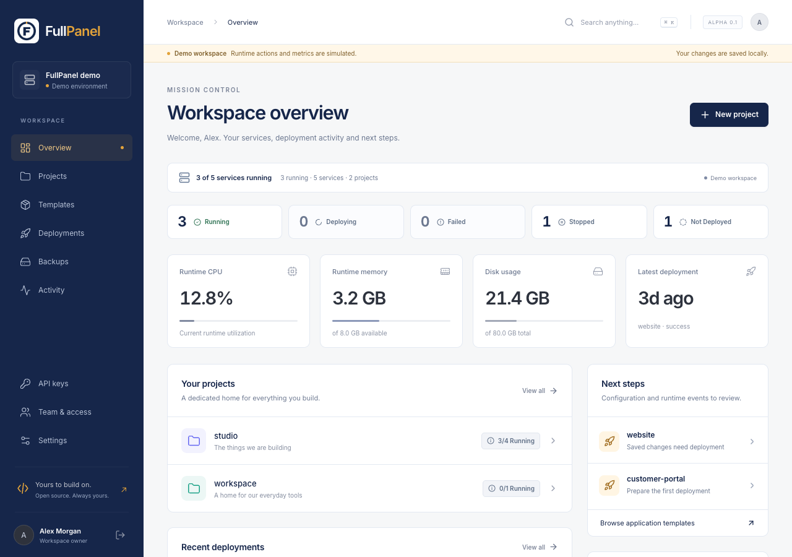
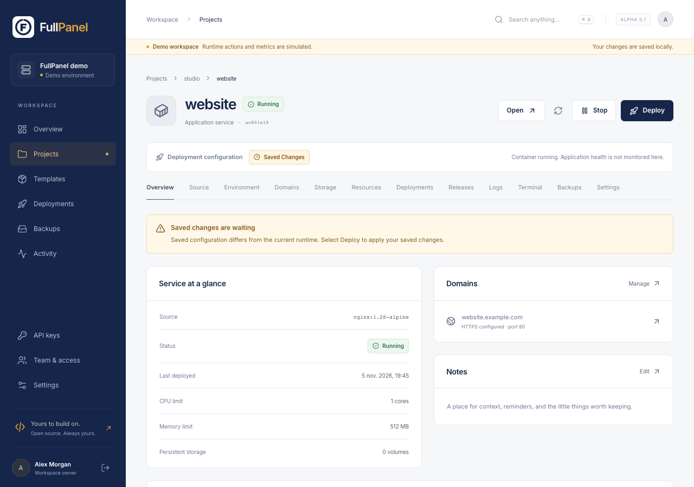
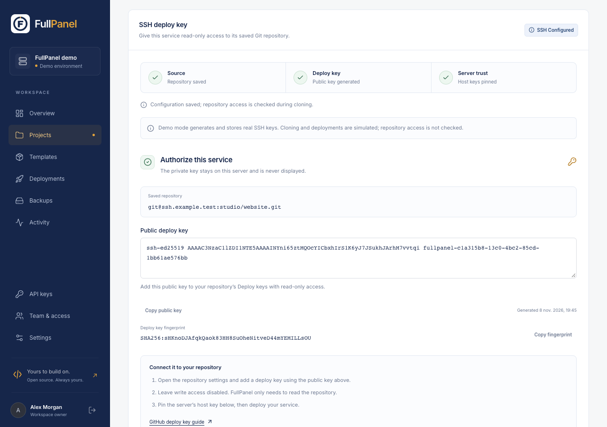
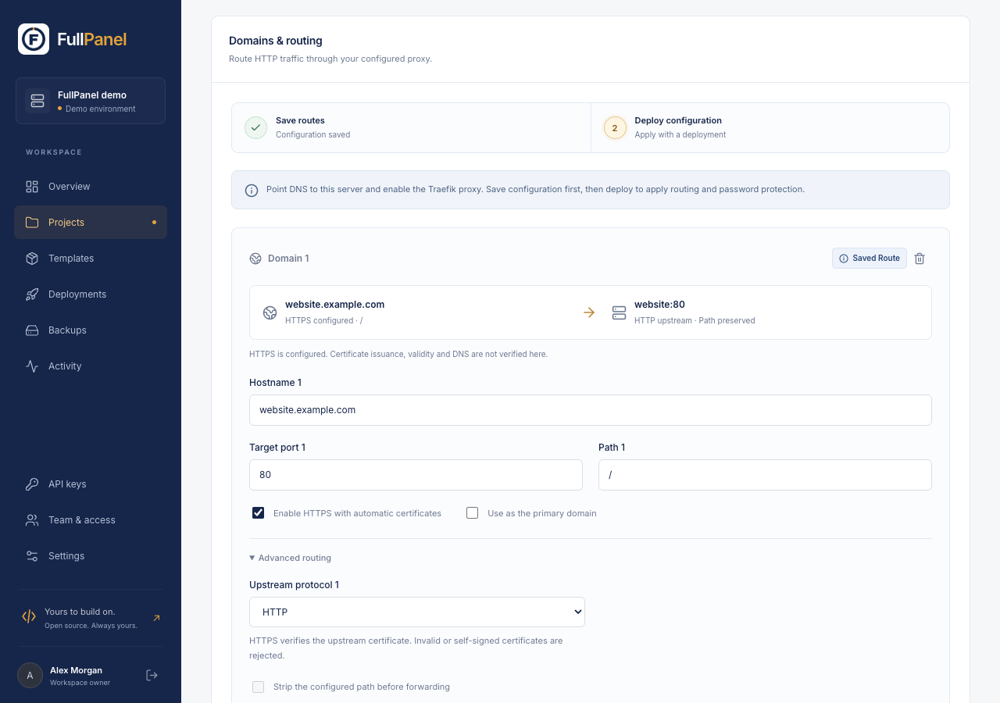
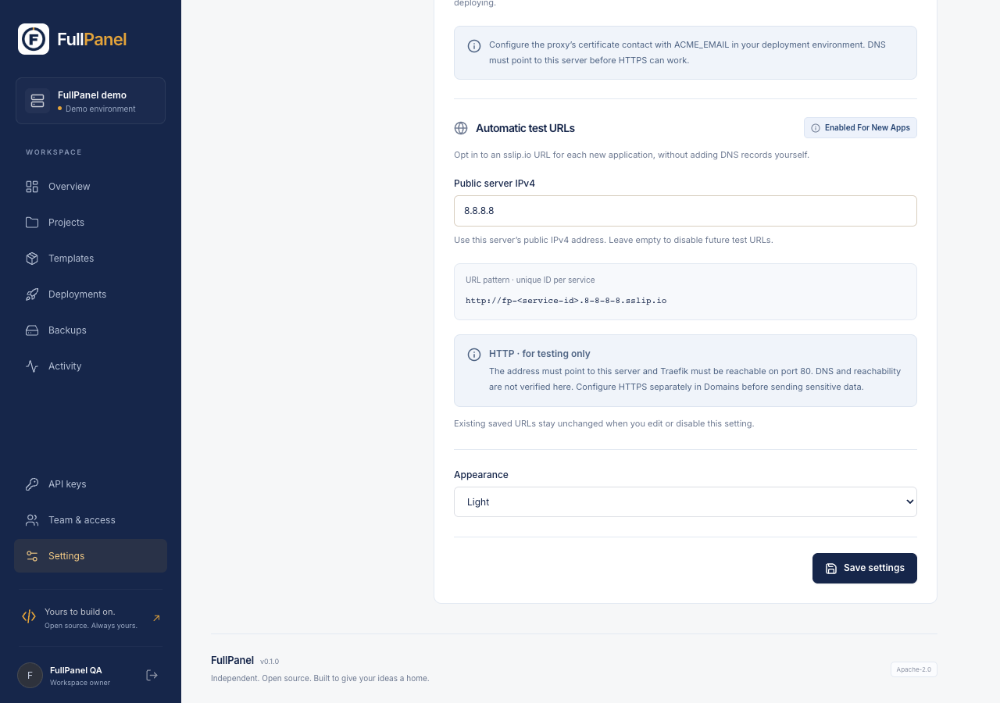
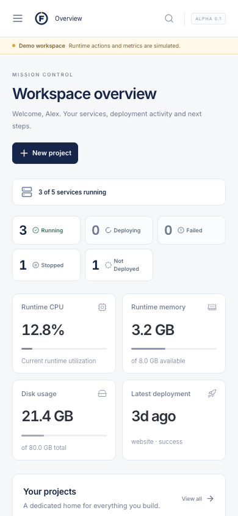
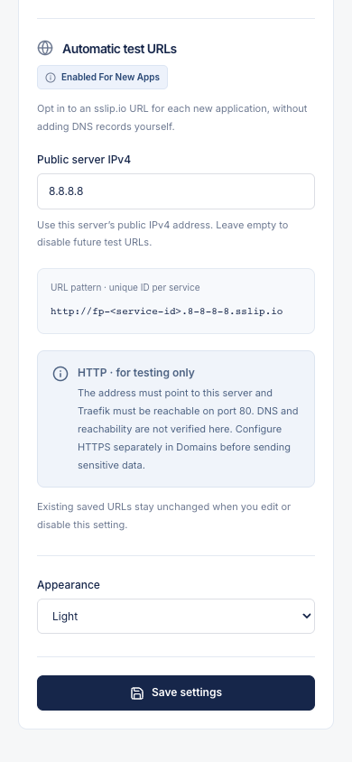

# FullPanel

**Your infrastructure. In good hands.**

Deploy your applications, manage your databases and follow your services from one dashboard on your own server. FullPanel is an open-source control panel for Docker workloads.

**Early development.** Check the [supported workflows and current limitations](docs/VERIFICATION.md) before relying on FullPanel for production workloads.



## What you can do

- **Deploy your applications** from Docker images, Dockerfiles or Git repositories, including private repositories with SSH deploy keys.
- **Manage your databases** with PostgreSQL, MySQL, MariaDB, MongoDB and Redis services.
- **See what needs attention** with service status, deployment history, logs and visible pending changes.
- **Give each app an address** with custom domains, HTTPS configuration and optional HTTP test URLs without manual DNS records.
- **Protect your data** with scheduled local backups and restoration to compatible services.
- **Return to a previous app version** using saved releases while keeping current volume data.
- **Work with your team** through project permissions, shared environment variables and scoped API keys.

## Interface tour

Explore the dashboard, deployment controls and mobile views below. Screenshots use demonstration data; select one to view it at full size.

| Services at a glance | Private Git over SSH |
| --- | --- |
| [](docs/images/inter-service-overview.png) | [](docs/images/inter-git-ssh-desktop.png) |
| **Know where you stand** — see what is running and what still needs deployment. | **Connect private repositories** — set up a deploy key and verify your Git server. |

| Domains and routing | Automatic test URLs |
| --- | --- |
| [](docs/images/inter-domain-desktop.png) | [](docs/images/r08-test-urls-desktop.png) |
| **Connect your domains** — manage each application's address and routing in one place. | **Try a deployed app** — configure your server's public IPv4 once for automatic HTTP test URLs. |

<details>
<summary><strong>Mobile views</strong></summary>

<table>
  <tr>
    <th>Workspace overview</th>
    <th>Test URL settings</th>
  </tr>
  <tr>
    <td align="center"><a href="docs/images/inter-dashboard-mobile.png"></a></td>
    <td align="center"><a href="docs/images/r08-test-urls-mobile.png"></a></td>
  </tr>
</table>

</details>

## Run locally

Requirements: Node.js 22.13+ (24 LTS recommended), npm, and Docker Engine with Compose and Buildx for real deployments.

For MongoDB deployments, check [host compatibility](docs/VERIFICATION.md#environment-and-image-provenance) before choosing your server.

```sh
git clone https://github.com/mehdinajeddine/fullpanel.git
cd fullpanel
npm ci
npm run dev
```

Open http://127.0.0.1:5173 and create your owner account. By default, FullPanel deploys real workloads through Docker.

To explore without creating containers:

```sh
HARBORLIGHT_MODE=demo DATA_DIR=.data/demo npm run dev
```

Demo mode displays a persistent banner, uses illustrative data, and simulates deployment operations. Keep demo and real state in separate data directories.

## Install on a server

Clone FullPanel to a server with Docker Engine and the Compose plugin installed, then run:

```sh
sh scripts/install.sh
```

The installer builds and starts FullPanel. Its administration port is accessible only from the server until you configure remote access.

On a remote server, forward the loopback port to complete setup:

```sh
ssh -L 3000:127.0.0.1:3000 user@your-server
```

Open http://127.0.0.1:3000 through that tunnel. Create the owner before exposing the administration interface.

### Application domains and HTTPS

Start the optional Traefik proxy for application routes. Custom HTTPS domains also require DNS A/AAAA records pointing to this server, `ACME_EMAIL` in `.env`, and reachable ports 80 and 443:

```sh
docker compose --profile proxy up -d
```

Create a project and service, add its hostname and internal application port in **Domains**, save, then **Deploy**. The proxy routes requests to your application and requests certificates for HTTPS domains. A saved domain is configuration, not proof that DNS or a certificate is ready.

For HTTP test URLs without adding DNS records yourself, open **Settings → Automatic test URLs → Public server IPv4** and save this server's public IPv4. New applications receive `http://fp-<service-UUID-without-hyphens>.<IPv4-with-hyphens>.sslip.io`. Leave the field empty to disable future allocations. This opt-in setting supports public IPv4 only; it does not discover the address or verify DNS/reachability. Traefik must be reachable on port 80 and the application target port must be correct; templates use their declared port. The external sslip.io DNS service must remain available. Use HTTPS separately before sending sensitive data.

A configured **Base domain** takes priority and gives new applications the existing `<service>-<project>.<baseDomain>` HTTPS route; its DNS remains your responsibility. Settings changes do not rewrite saved routes. Databases, Compose services and creation requests with explicit domains (including an empty list) do not receive an automatic test URL. See the [implemented subset and remaining acceptance criteria](docs/specs/14-default-test-domain.md). The effective proxy email is `ACME_EMAIL`; saving the panel's email setting does not currently reconfigure Traefik. Public HTTP reachability and certificate issuance/renewal remain separate, unverified checks.

To expose the panel itself over HTTPS after owner setup, configure `PANEL_DOMAIN` and `ACME_EMAIL` in `.env`:

```sh
docker compose -f compose.yaml -f compose.public.yaml --profile proxy up -d
```

### Private Git repositories over SSH

Save a Git source such as `git@github.com:team/app.git` or `ssh://git@forge.example.com:2222/team/app.git`. In **Source**, generate a deploy key, copy the public key and add it to that repository's deploy keys with read-only access. FullPanel keeps the private key encrypted and never returns it through the API.

Before deployment, paste the Git server's verified `known_hosts` entry and check its SHA256 fingerprint against the provider's official documentation or your server administrator. For a custom SSH port, the entry must use `[hostname]:port`. FullPanel refuses unverified or changed host keys, ambient SSH agents and host configuration. Private submodules and Git LFS are not supported.

Keys belong to the saved service and exact repository. A repository change removes the credential; changing the branch retains it. After rotating a key, register the new public key before deploying. Removing a key in FullPanel does not remove its public deploy key from the Git provider; revoke that entry there as well.

### Data and updates

The `harborlight-data` volume contains panel state, its encryption key, build workspaces, and local backups. Back up **the entire data volume**, including `encryption.key`, while the panel is stopped. The key is required to recover the encrypted state. Service data lives in separate named Docker volumes; back those up independently.

```sh
git pull --ff-only
docker compose up -d --build panel
```

Deleting a service retains its named volumes. Inspect and remove unwanted volumes explicitly after confirming recovery is unnecessary. `docker compose down` stops the panel and optional proxy; it does not stop separately deployed applications. Avoid `down --volumes` unless you intend to remove panel data and certificates.

## Variables and recovery

Open a project's **Environment** tab to manage shared defaults. Services inherit those values and can override individual keys, including with an empty value. **Import .env** previews changes locally before applying them to the editor; **Save** persists the draft, and **Deploy** applies it to the workload. Compose precedence is service values, child YAML values, then project defaults. Values are literal and multiline imports are unsupported.

In **Backups**, select **Restore** on a recent verified backup, choose a compatible running destination and type its exact name. The panel checks integrity, creates a safety backup and imports into new volumes before switching containers. Database recovery adopts the backup's database names and credentials. Original volumes remain for recovery and consume disk space. The journal links to the safety backup and records failures; unresolved restart recovery blocks further changes to the affected service.

Restore requires Docker mode and new backup metadata. Legacy/demo backups, Compose, external archive uploads and engine upgrades are unsupported. Application volume backups copy live files; stop application writes when a consistent snapshot is needed. Archives containing links or extended tar headers are currently refused. See the [restore contract](docs/specs/10-local-restoration.md) and the [verified engine scopes](docs/VERIFICATION.md).

## People and automation

Use **Team & access** to create administrators or members with viewer/operator access to selected projects. Viewers see status without environment secrets, deployment output, runtime logs or backup downloads. Operators can configure and run workloads in their projects. Treat operators as trusted application administrators, not isolated tenants.

Create a personal key in **API keys**, select its projects and read/write permission, then store the one-time token in your CI secret manager. The CLI reads `HARBORLIGHT_API_KEY` from the environment:

```sh
export HARBORLIGHT_URL=https://panel.example.com
# Configure HARBORLIGHT_API_KEY through your shell or CI secret manager.
node scripts/harborlight.mjs projects
node scripts/harborlight.mjs services
node scripts/harborlight.mjs deploy SERVICE_UUID --wait
```

The CLI prints JSON, refuses HTTP redirects, and exits unsuccessfully when a waited deployment fails. `--help` lists commands. Keys cannot manage accounts, server settings or other keys. Revocation and reduced account permissions take effect on subsequent requests.

## Current scope

FullPanel currently manages services on a single Docker host. Interactive terminals, offsite backups and rolling deployments are still in development. Public certificate issuance and renewal remain unverified. An [EasyPanel and Portainer migration assistant](docs/specs/15-platform-migration.md) is planned.

Also planned: [FullPanel Mobile](docs/specs/16-mobile-monitoring.md), an iOS and Android app to pair your phone by scanning a QR code and follow your servers and services in read-only mode. It is not available yet.

## Documentation

- [GitHub automatic deployments](docs/specs/12-github-auto-deploy.md)
- [Restoring a previous application release](docs/specs/13-application-releases.md)
- [Backup restoration](docs/specs/10-local-restoration.md)
- [Detailed functional and technical specifications — French DOCX](docs/deliverables/FullPanel_Specifications_fonctionnelles_et_techniques.docx)
- [Current support and verification](docs/VERIFICATION.md)

## Contributing

FullPanel is available under the [Apache-2.0 license](LICENSE). To contribute, see [CONTRIBUTING.md](CONTRIBUTING.md). Report security issues through the [security policy](SECURITY.md).
