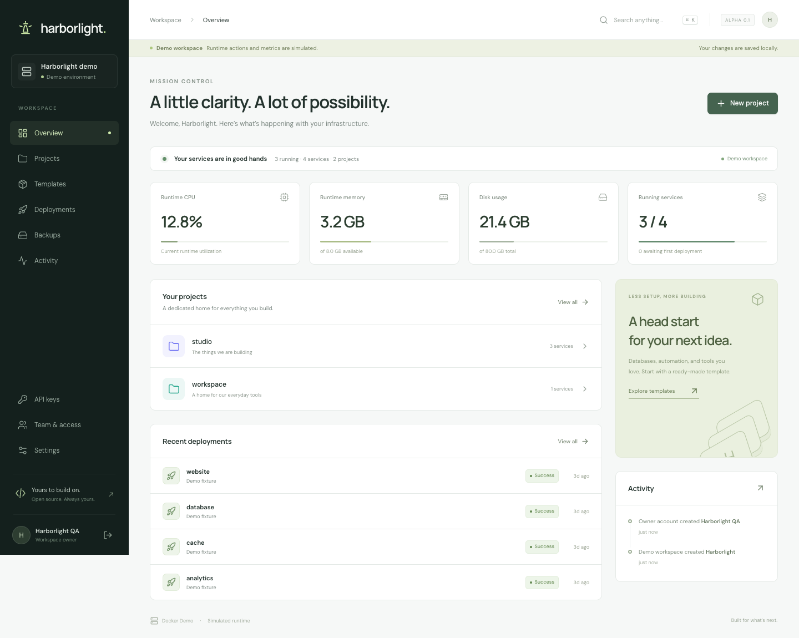

# Harborlight

**Your infrastructure. In good hands.**

An independent, open-source control panel for applications and databases on your own Docker host. An original interface and implementation, informed by the workflows documented in Easypanel. Apache-2.0 licensed.

**Status: early development.** The [feature matrix](docs/FEATURE-PARITY.md) records observed reference behavior, acceptance criteria, and implementation status. Harborlight does not claim complete Easypanel parity. See [verification](docs/VERIFICATION.md) for what has actually been exercised.



The current release includes projects and services, image/Git/Dockerfile deployments, a restricted Compose runtime, database configuration, domains, shared project variables with service overrides and `.env` import, named volumes, resource limits, deployment output, runtime logs, local backups, UTC backup schedules with retention, verified local restoration with safety backups, and revocable deployment triggers. It also provides accounts with project permissions, scoped API keys and a CLI, private image and HTTPS Git credentials, and proxy password protection, prefix removal, wildcard HTTP routes and HTTPS redirects. The interface supports light and dark themes, mobile layouts, and keyboard search.

Native GitHub webhooks, private build base images, SSH deploy keys, offsite storage, interactive terminals, rolling deployments, and the reference product's advanced workloads remain tracked work. This release manages standalone Docker containers; it does not provide Swarm parity.

## Run locally

Requirements: Node.js 22.13+ (24 LTS recommended), npm, and Docker Engine with Compose and Buildx for real deployments.

```sh
npm ci
npm run dev
```

Open http://127.0.0.1:5173 and create the initial owner account. The backend binds to loopback by default. Docker mode is the default; Docker failures are reported rather than replaced with simulated results.

To explore without creating containers:

```sh
HARBORLIGHT_MODE=demo DATA_DIR=.data/demo npm run dev
```

Demo mode displays a persistent banner, uses illustrative data, and simulates deployment operations. Keep demo and real state in separate data directories.

## Install on a server

Clone your Harborlight repository to a server with Docker Engine and the Compose plugin installed, then run:

```sh
sh scripts/install.sh
```

This builds from source and starts the panel. It does not install Docker, join or leave a Swarm, or expose the administration port publicly. The installer is equivalent to:

```sh
cp .env.example .env
docker compose up -d --build panel
```

On a remote server, forward the loopback port to complete setup:

```sh
ssh -L 3000:127.0.0.1:3000 user@your-server
```

Open http://127.0.0.1:3000 through that tunnel. Create the owner before exposing the administration interface.

### Application domains and HTTPS

Point the domain's DNS A/AAAA records at this server. Set `ACME_EMAIL` in `.env`, ensure ports 80 and 443 are available, and start the optional Traefik proxy:

```sh
docker compose --profile proxy up -d
```

Create a project and service, add its hostname and internal application port in **Domains**, save, then **Deploy**. Services with domains join the `harborlight-proxy` network. The bundled proxy discovers container labels and requests certificates for HTTPS domains. A saved domain is configuration, not proof that DNS or a certificate is ready.

To expose the panel itself over HTTPS after owner setup, configure `PANEL_DOMAIN` and `ACME_EMAIL` in `.env`:

```sh
docker compose -f compose.yaml -f compose.public.yaml --profile proxy up -d
```

### Data and updates

The `harborlight-data` volume contains panel state, its encryption key, build workspaces, and local backups. Back up **the entire data volume**, including `encryption.key`, while the panel is stopped. The key is required to recover the encrypted state. Service data lives in separate named Docker volumes; back those up independently.

```sh
git pull --ff-only
docker compose up -d --build panel
```

Deleting a service retains its named volumes. Inspect and remove unwanted volumes explicitly after confirming recovery is unnecessary. `docker compose down` stops the panel and optional proxy; it does not stop separately deployed applications. Avoid `down --volumes` unless you intend to remove panel data and certificates.

## Variables and recovery

Open a project's **Environment** tab to manage shared defaults. Services inherit those values and can override individual keys, including with an empty value. **Import .env** previews changes locally before applying them to the editor; **Save** persists the draft, and **Deploy** applies it to the workload. Compose precedence is service values, child YAML values, then project defaults. Values are literal and multiline imports are unsupported.

In **Backups**, select **Restore** on a recent verified backup, choose a compatible running destination and type its exact name. The panel checks integrity, creates a safety backup and imports into new volumes before switching containers. Database recovery adopts the backup's database names and credentials. Original volumes remain for recovery and consume disk space. The journal links to the safety backup and records failures; unresolved restart recovery blocks further changes to the affected service.

Restore requires Docker mode and new backup metadata. Legacy/demo backups, Compose, external archive uploads and engine upgrades are unsupported. Application volume backups copy live files; stop application writes when a consistent snapshot is needed. Archives containing links or extended tar headers are currently refused. See the [restore contract](docs/specs/10-local-restoration.md) and the [verified engine scopes](docs/VERIFICATION.md).

## People and automation

Use **Team & access** to create administrators or members with viewer/operator access to selected projects. Viewers see status without environment secrets, deployment output, runtime logs or backup downloads. Operators can configure and run workloads in their projects. Treat operators as trusted application administrators, not isolated tenants.

Create a personal key in **API keys**, select its projects and read/write permission, then store the one-time token in your CI secret manager. The CLI reads `HARBORLIGHT_API_KEY` from the environment:

```sh
export HARBORLIGHT_URL=https://panel.example.com
# Configure HARBORLIGHT_API_KEY through your shell or CI secret manager.
node scripts/harborlight.mjs projects
node scripts/harborlight.mjs services
node scripts/harborlight.mjs deploy SERVICE_UUID --wait
```

The CLI prints JSON, refuses HTTP redirects, and exits unsuccessfully when a waited deployment fails. `--help` lists commands. Keys cannot manage accounts, server settings or other keys. Revocation and reduced account permissions take effect on subsequent requests.

## Development and checks

```sh
npm run typecheck
npm test
npm run build
npx playwright install chromium
npm run test:e2e
```

The browser suite builds and starts an isolated production server in demo mode. Docker checks are separately opt-in because they create real containers and volumes:

```sh
npm run test:docker
npm run test:proxy
npm run test:credentials
npm run test:git
npm run test:environment
# Cached PostgreSQL, Redis, Nginx and alpine:3.21 images are required.
HARBORLIGHT_RESTORE_TEST_ENGINES=postgres,redis,app npm run test:restore
# Requires a production browser build and installed Playwright browser.
npm run test:restore-ui
npm run test:restore-recovery
docker build -t harborlight:local .
npm run test:package
```

These scripts clean up their disposable resources. The CI workflow exercises API/browser behavior, real Docker deployment and routing, and the built container.

## Architecture

- React + TypeScript + Vite, with an original responsive interface.
- Fastify API; per-project access controls, scoped API keys and HttpOnly session cookies.
- Encrypted, atomically persisted local state for a single server process.
- Docker CLI subprocesses with explicit argument arrays and managed-resource labels.
- Traefik integration for host/path routing, bcrypt HTTP authentication and Let's Encrypt HTTPS.
- A separately selected demo runtime for local exploration and browser testing.

See [API-CONTRACT.md](API-CONTRACT.md), [reference analysis](docs/REFERENCE-ANALYSIS.md), and [security model](SECURITY.md).

## Contributing

See [CONTRIBUTING.md](CONTRIBUTING.md). Each feature should have an explicit acceptance criterion, an original implementation, and verification against its real runtime where relevant. Do not contribute proprietary source, extracted bundles, licensed product assets, or credentials.

Harborlight is not affiliated with or endorsed by Easypanel. The reference installer and extracted distribution used during analysis are not included in this repository.
